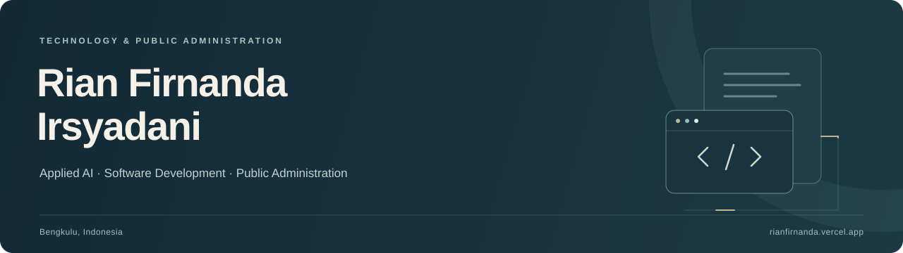

  

  
  
  
  

 

### About

My background combines **applied AI, software engineering, and public administration**.

**AI & data.** Python, R, SPSS, machine learning fundamentals, sentiment analysis, model retraining and integration, generative AI, prompt engineering, and Google AI Studio.

**Software & cloud.** PHP, Laravel, CodeIgniter, JavaScript, React, HTML/CSS, databases, Firebase / Cloud Firestore, Git, Google Cloud, and AWS foundations.

**Systems & security.** Application maintenance, debugging, operating systems, networking, and cybersecurity analysis, supported by the **Certified Cyber Security Analyst (C3SA)** credential.

**Public administration.** My studies and practical experience cover office administration, records management and archiving, official correspondence, document verification, data entry, and report preparation. I have also studied public policy, government administration, and public sector management, and supported institutional quality assurance documentation.

 

---

  Open to work and project collaboration 
  <a href="mailto:rianfirnanda1@gmail.com">rianfirnanda1@gmail.com</a>

