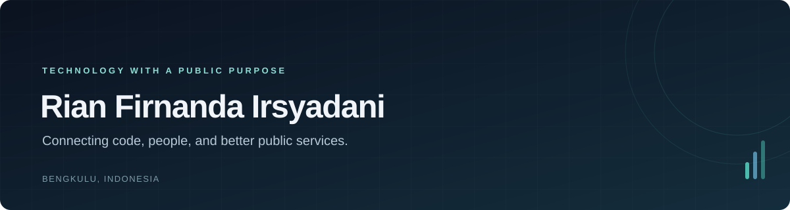

  

  
  
  
  

  <a href="#about">About</a> &nbsp;·&nbsp;
  <a href="#toolkit">Toolkit</a> &nbsp;·&nbsp;
  <a href="#background">Background</a>

 

### About

I develop websites and manage the content, systems, and documentation behind them. My background is in **software engineering and public administration**, with experience supporting academic websites and administrative work at Universitas Bengkulu.

Most of my web development work uses **PHP, Laravel, and CodeIgniter**. I also work with WordPress and explore AI tools for research, documentation, and everyday administrative tasks.

 

### Toolkit

WEB DEVELOPMENT

  
  
  
  
  
  

TOOLS &amp; PLATFORMS

  
  
  
  

  Website maintenance &nbsp;·&nbsp; Technical support &nbsp;·&nbsp; Data &amp; documentation

 

### Background

**Public Administration · Universitas Bengkulu**  
Graduated with honors · GPA **3.84/4.00**

Previously studied Software Engineering at SMKN 1 Kota Bengkulu. Alongside website management, I have supported internal quality audits, accreditation documentation, and alumni tracer studies.

<strong>Research &amp; recognition</strong>

 

My research looks at the implementation of the Family Information System (SIGA) in Bengkulu Province.

- **Lead author** — “Bridging Centralized Design and Local Realities: Implementation Strategies for the Family Information System (SIGA) in Bengkulu Province.” Published in the *Journal of Social and Policy Issues* (Sinta 4), 2026.
- **3rd Place, Best Paper** — Population Administration & Digital Inclusion, BGSF 2026, for “Bridging Design-Reality Gaps in a National Family Information System.”

[Publications](https://rianfirnanda.vercel.app/#publications) · [Google Scholar](https://scholar.google.com/citations?user=PW0IcAsAAAAJ&hl=en)

<strong>Selected credentials</strong>

 

- **Software Engineering, KKNI Level II** — BNSP
- **[Certified Cyber Security Analyst](https://www.credential.net/2792781d-aa04-4f71-9f0c-4513d8ea6499)** — CyberWarFare Labs
- **[Generative AI Leader](https://www.coursera.org/account/accomplishments/professional-cert/FQ7Y9J473BAT)** — Google Cloud
- **[AI Fluency: AI Capabilities & Limitations](https://verify.skilljar.com/c/2ezoyenn7p5f)** — Anthropic

[All certifications](https://rianfirnanda.vercel.app/#certifications)

 

---

  Open to work and project collaboration 
  <a href="mailto:rianfirnanda1@gmail.com">rianfirnanda1@gmail.com</a>

